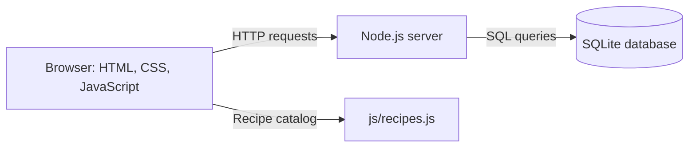

# CookIT Recipe Website

## Project Report

**Student:** [Your name]  
**Course / class:** [Course or class]  
**Instructor:** [Instructor name]  
**Date:** [Submission date]

## 1. Project Summary

CookIT is a responsive recipe website for people who want approachable meal ideas and clear cooking instructions. Visitors can browse and search recipes, filter by meal category, open step-by-step instructions, adjust ingredient quantities, and save favorites. The project includes a Node.js backend and an SQLite database for user accounts, login sessions, and favorites.

The system runs locally at `http://127.0.0.1:4173`. It is a classroom/local-development project, not a production-hosted service.

## 2. Problem and Purpose

People who are new to cooking may find it difficult to choose a recipe, understand the sequence of steps, or keep track of ingredients. CookIT brings these tasks together in one place with categorized recipes, a searchable recipe list, and a focused cook-along view.

## 3. Goals

- Provide a clear, responsive interface for desktop and mobile browsers.
- Let users find recipes by name, ingredient, or category.
- Present ingredients, tools, preparation information, and numbered instructions.
- Allow users to adjust servings and check ingredients as they prepare them.
- Let users create an account, sign in, sign out, and save favorites.
- Store account, session, and favorite data in SQLite rather than only in browser storage.

## 4. Scope and Features

### Website pages

- **Home:** introduction, search, category filters, and featured recipes.
- **Recipes:** searchable and sortable recipe catalog.
- **Recipe details:** ingredients, kitchen tools, cooking steps, progress, and serving adjustment.
- **Categories:** links into breakfast, lunch, dinner, snacks, and desserts.
- **Favorites:** signed-in users' saved recipes.
- **How to cook:** beginner cooking notes.
- **About and Contact:** project information and a contact-form demonstration.
- **Login:** sign-in and account creation.

### Current recipe catalog

The catalog currently contains eight recipes: pancakes, chicken adobo, tomato-basil pasta, chickpea salad, omelet, smash burgers, chocolate cookies, and oven fries. Recipe definitions are stored in `js/recipes.js`; they are not yet stored in SQLite.

## 5. System Architecture

CookIT has three main parts:

1. **Frontend:** HTML pages, shared CSS, and browser JavaScript provide the interface and call the API.
2. **Backend:** `server.js` serves the website and handles registration, authentication, sessions, and favorites.
3. **Database:** SQLite persists user records, sessions, and favorite recipe IDs in `data/cookit.sqlite`.

### Database tables

| Table | Purpose |
|---|---|
| `users` | User ID, display name, username, email, password salt/hash, and creation time. |
| `sessions` | Hashed session token, owning user, and expiration time. |
| `favorites` | User-to-recipe relationship and save time. |

Usernames and email addresses are unique without regard to letter case. Favorites reference recipe IDs from the frontend catalog.

## 6. Technology

- HTML for page structure.
- CSS for responsive layout, shared styles, and light/night themes.
- JavaScript for browser interactions and API requests.
- Node.js 24 with its built-in HTTP and SQLite modules.
- SQLite for persistent local data; no separate database server or npm package is required.
- Unsplash image URLs for recipe photography; an internet connection is needed to load them.

## 7. Authentication and Data Handling

Registration and login are handled by the backend API. Passwords are salted and hashed on the server with Node's `scrypt` function; plaintext passwords are not written to the database. The browser receives an HTTP-only, same-site session cookie. Session records store a hash of the cookie token and an expiration time. Signing out invalidates the server session and clears the cookie.

The application is intended for local development. Before public deployment, it would need HTTPS, production configuration, request-rate limiting, monitoring, database backup procedures, and a security review.

## 8. Main API Routes

| Method and route | Purpose |
|---|---|
| `GET /api/setup-status` | Reports whether an account already exists, for the initial login screen. |
| `POST /api/register` | Validates and creates a user account. |
| `POST /api/login` | Verifies credentials and starts a session. |
| `GET /api/me` | Returns the current user, or `null` when signed out. |
| `POST /api/logout` | Removes the current session and clears its cookie. |
| `GET /api/favorites` | Lists the signed-in user's saved recipe IDs. |
| `PUT /api/favorites` | Adds or removes a recipe from that user's favorites. |

## 9. Setup and Use

1. Install Node.js 24 or newer.
2. Open a terminal in the project folder.
3. Run `node server.js`.
4. Visit `http://127.0.0.1:4173` in a browser.
5. On a fresh database, create an account. After registration, sign in with that username and password.

The server creates the `data` folder and SQLite database automatically. To move the project, copy the complete folder, including `data/cookit.sqlite`, and run it on a PC with a compatible Node.js version.

## 10. Testing

The following flows were checked in a browser against the running local server:

- Empty-database and existing-account login-screen states.
- Account creation returning to the sign-in form.
- Password mismatch and incorrect-password validation.
- Successful sign-in, session creation, and logout.
- Access control for signed-out users.
- Saving and retrieving favorites through the API and SQLite.
- Recipe search, category filters, serving adjustment, and step navigation.
- Mobile layout and browser error checks.

## 11. Limitations and Future Work

- Recipe definitions are currently hard-coded in `js/recipes.js`, not editable through an administrator interface or stored in the database.
- The contact form displays a demo confirmation and does not transmit or store messages.
- Password reset, email verification, account management, and administrative tools are not implemented.
- The server is for local development and is not hardened for public deployment.
- Recipe photos depend on external URLs and internet access.

Possible next steps include moving recipes into SQLite, adding a contact-service backend, adding password-reset and email-verification flows, and deploying behind HTTPS with production security controls.

## 12. Conclusion

CookIT combines a practical recipe interface with a small full-stack backend. It demonstrates how a browser frontend can communicate with a Node.js API and persist account-related data in SQLite, while keeping the recipe browsing experience simple and usable.